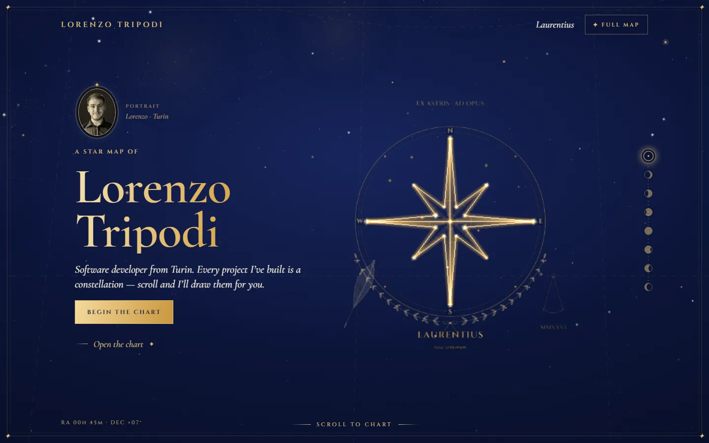
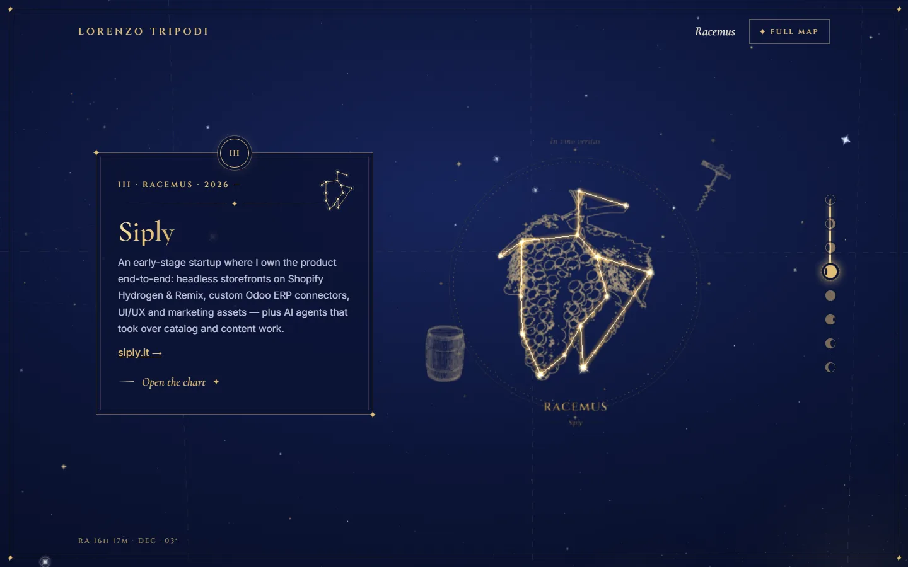
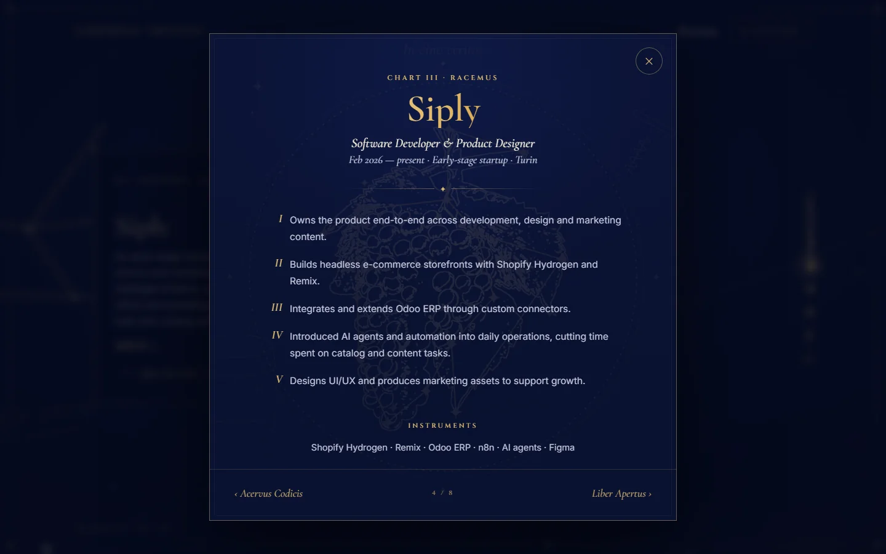

# Starmap portfolio

[](https://github.com/Eltymus/starmap-portfolio/actions/workflows/ci.yml)
[](LICENSE)

**Live: [eltymus.github.io/starmap-portfolio](https://eltymus.github.io/starmap-portfolio/)**

Personal portfolio of **Lorenzo Tripodi** — a gold-on-navy star map in Three.js. Every section draws a constellation over
an engraving; each star holds a note, and "Open the chart" shows the full details.

Built with [Astro](https://astro.build) (static output), strict TypeScript, plain CSS and [Three.js](https://threejs.org).
Deployed to GitHub Pages by a CI pipeline that publishes only when every check passes.



<p>
  
  
</p>

## Highlights

- **Performance.** The page script is 39 kB (15 kB gzip); Three.js and the scene (561 kB, 139 kB gzip) load afterwards
  with a dynamic `import()`, so the text never waits for WebGL. Engravings are lossless WebP, the main fonts are
  preloaded and self-hosted.
- **Lighthouse** (live site, Lighthouse 13.6, November 2026). Accessibility, Best Practices and SEO 100 on both mobile
  and desktop. Performance 68 on mobile and 70 on desktop, with LCP 1.2 s / 0.3 s and no layout shift. The points are
  lost on Total Blocking Time: building the 3D sky and compiling its shaders for the first frame runs on the main
  thread, and headless Chrome does it on a software GPU. To reproduce:
  `npx lighthouse https://eltymus.github.io/starmap-portfolio/`.
- **Resilience.** Without WebGL the page shows a static sky and keeps working; if the GPU drops the WebGL context, the
  render loop pauses and resumes when it comes back. Both paths are tested.
- **Security without headers.** GitHub Pages cannot set headers, so a strict Content-Security-Policy ships as a
  `<meta>` tag; an end-to-end test walks through the whole site and fails on any violation.
- **Accessibility.** Native `<dialog>`s with focus management, every hover note also reachable by keyboard and screen
  reader, `prefers-reduced-motion` honoured down to the 3D scene, axe-core scans in CI.
- **Tested end to end.** 85 unit tests (Vitest) for the pure logic — pen-stroke ordering, sky coordinates, content data —
  and 83 Playwright runs on desktop and mobile: navigation, dialogs, keyboard, SEO, CSP, WebGL fallback and screenshot
  comparisons, run in the same Linux container locally and in CI.
- **Maintained.** Strict TypeScript, ESLint, Stylelint and Prettier gate every commit; Dependabot keeps dependencies
  current; `npm audit` is clean; commits follow Conventional Commits and changes are logged in `CHANGELOG.md`.
- **Search and sharing.** Canonical URLs, Open Graph and Twitter cards with a share image rendered from the real sky,
  a schema.org `Person` in JSON-LD, a sitemap and a themed 404 page.

## Run locally

Requires Node 22.23.4 or later in the 22 line (`.nvmrc`; `nvm use` picks it up), the version CI uses.

```bash
npm install
npm run dev        # http://localhost:4321/starmap-portfolio/
npm run build      # static site in dist/
npm run preview
```

## Quality checks

| Command                  | What it does                                                                                     |
| ------------------------ | ------------------------------------------------------------------------------------------------ |
| `npm run lint`           | ESLint (JS/TS/Astro), Stylelint (CSS) and a Prettier format check                                |
| `npm run format`         | Rewrites every file in the house style (Prettier)                                                |
| `npm run check`          | Type-checks the whole project with `astro check`                                                 |
| `npm test`               | Unit tests (Vitest) for the pure logic: pen trails, maths, sky coordinates, chapter data         |
| `npm run test:e2e`       | End-to-end tests (Playwright) against the built site: navigation, dialogs, keyboard, screenshots |
| `npm run test:e2e:linux` | The same suite inside the Linux container used by CI (needs Docker)                              |
| `npm run verify`         | Everything above, in the order CI runs it                                                        |
| `npm run static-sky`     | Redraws `public/img/static-sky.webp`, the flat sky shown when WebGL is unavailable               |
| `npm run og-image`       | Redraws `public/og-image.jpg`, the 1200×630 share image, from the built site (run after a build) |

Screenshot baselines live in `tests/e2e/__screenshots__/`, one set per platform. CI compares against the Linux set; after an intentional visual change, refresh it with `npm run build && npm run test:e2e:linux -- --update-snapshots` (and `npm run test:e2e:update` for the local set).

## Accessibility

- The chart sheet and the full map are native `<dialog>` elements opened with `showModal()`: the page behind is inert, Escape closes them and focus returns to the control that opened them.
- Every star note shown on hover is also listed under **The stars** at the end of each chart sheet, for keyboard and screen reader users.
- With `prefers-reduced-motion`, scrolling is instant, CSS animations stop, and the 3D sky stops twinkling: constellations appear already drawn, without sparks or shooting stars.
- An axe-core scan of the page and of both dialogs runs in the end-to-end suite.

## Where things live

How the pieces fit together (start-up, the shared state, the scene, the failure paths and the trade-offs) is explained
in [docs/architecture.md](docs/architecture.md).

| Path                     | What                                                                                                                              |
| ------------------------ | --------------------------------------------------------------------------------------------------------------------------------- |
| `src/data/chapters.ts`   | All content, one object per chapter: name, subtitle, star notes, chart-sheet page, constellation geometry and layout tweaks       |
| `src/data/types.ts`      | Types of the content (`Chapter`, `Sheet`, `Figure`): a misspelt or missing field fails the build                                  |
| `src/pages/index.astro`  | The page: the text of every section, composed from components                                                                     |
| `src/components/`        | Reusable Astro pieces: `Chapter` (section + card), `Button`, `Link`, `Chips`, `StackList`, `Timeline`, dialogs, moon nav, header… |
| `src/layouts/Base.astro` | `<head>`: fonts (self-hosted via Fontsource), canonical URL, Open Graph / Twitter cards, JSON-LD `Person`                         |
| `src/pages/404.astro`    | The "uncharted sky" page GitHub Pages serves for any missing address                                                              |
| `src/lib/`               | Shared helpers: asset URLs, math, colour palette and canvas fonts                                                                 |
| `src/scripts/starmap.ts` | Entry point that wires the UI and the 3D scene together                                                                           |
| `src/scripts/ui/`        | Navigation, chart sheet, full map, star tooltip, keyboard, shared dialog behaviour                                                |
| `src/scripts/scene/`     | Three.js: renderer loop, sky, star shader, constellations, shooting star, textures                                                |
| `src/scripts/art/`       | Canvas engravings: drawing primitives, the engraving and decorations of each chapter                                              |
| `src/styles/`            | One CSS file per component, imported in order by `global.css`; colours, fonts and easings live in `tokens.css`                    |
| `docs/images/`           | Screenshots used in this README (not deployed)                                                                                    |
| `public/img/`            | Gold engravings behind the constellations and the portrait                                                                        |

### Common edits

- **Change a colour or font**: `src/styles/tokens.css` (CSS) and `src/lib/theme.ts` (canvas / SVG drawn in JS).
- **Change a section's text**: `src/pages/index.astro`.
- **Change a chart sheet, star notes or a constellation**: the chapter's object in `src/data/chapters.ts`.
- **Change a chapter's engraving**: the function with the chapter `id` in `src/scripts/art/engravings.ts` and `decorations.ts`.

## Without WebGL

- If the browser has no WebGL, `new WebGLRenderer` throws: the page catches it, shows `public/img/static-sky.webp`
  instead of the 3D sky, closes the intro and still draws the engravings for the chart sheet and the full map.
  The same happens if the 3D chunk fails to load.
- If the GPU drops the WebGL context, the render loop pauses and the static sky covers the canvas until the context is
  restored; three rebuilds its buffers, textures and shaders and the loop resumes.
- Both cases are covered by `tests/e2e/webgl.spec.ts`.

## Search and sharing

- Every page has a canonical URL, Open Graph and Twitter card tags; the share image is `public/og-image.jpg`.
- The home page describes the author as a schema.org `Person` (name, role, city, GitHub and LinkedIn from `src/data/chapters.ts`).
- `@astrojs/sitemap` writes `sitemap-index.xml` at build time; `public/robots.txt` points to it. On a project site
  (`<user>.github.io/<repo>/`) crawlers only read the `robots.txt` at the domain root, so the sitemap is also linked from
  `<head>` and can be submitted in Google Search Console.

## Security

- GitHub Pages cannot send custom headers, so the Content-Security-Policy is a `<meta>` tag, built from `src/lib/csp.ts`
  and added to production builds only (the dev server needs inline scripts). It allows scripts, stylesheets and fonts from
  the site itself, `data:` images (the chart-sheet engravings) and inline style attributes. `frame-ancestors` cannot be
  set from a meta tag.
- An end-to-end test uses the whole site (WebGL sky, chart sheet, full map, 404) and fails on any CSP violation.

## Commits and changelog

Commit messages follow [Conventional Commits](https://www.conventionalcommits.org/en/v1.0.0/): `feat:`, `fix:`,
`perf:`, `build:`, `ci:`, `chore:`, `docs:`, `test:`, `refactor:`, with an optional scope (`fix(chart-sheet): …`).
Notable changes go in `CHANGELOG.md` under **Unreleased**. Run `npm run verify` before every commit.

## Deploy (GitHub Pages)

1. Push to the `main` branch of `github.com/<user>/starmap-portfolio`.
2. On GitHub: **Settings → Pages → Build and deployment → Source: GitHub Actions**.
3. The workflow in `.github/workflows/ci.yml` runs lint, type check, unit and end-to-end tests on every push and pull request; on `main`, only when they all pass, it builds and publishes to `https://<user>.github.io/starmap-portfolio/`.

If the GitHub username or repo name changes, update `site` and `base` in `astro.config.mjs`.

## Image credits

Engravings are public domain, traced in gold: Mole Antonelliana (image provided by the author), Leonardo da Vinci's icosahedron (Pacioli, _De divina proportione_, 1509), grapes (_The Cultivation of the Native Grape_, 1868), stair (_Stair-Building_), open book (Nodier, _The Bibliomaniac_, 1894), bird with letter (chapbook _History of Birds_, c. 1830); the 90s computer is an Openclipart drawing (public domain).

## License

The source code is released under the [MIT License](LICENSE).

The license does not cover the personal content: the texts about the author (`src/data/chapters.ts`,
`src/pages/index.astro`), the portrait (`public/img/portrait.webp`) and the share image (`public/og-image.jpg`) remain
© Lorenzo Tripodi, all rights reserved. The engravings are public domain (see above); the fonts keep their own licenses
(SIL Open Font License, via Fontsource).
