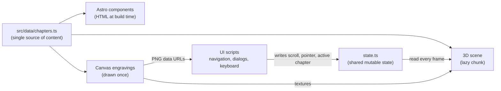

# Architecture

A short tour for anyone reading the code: how the page starts, where data flows, and why some choices were made.
For setup and scripts, see the [README](../README.md).

## The shape of it

The site is one static page built by Astro. All the text (every chapter, the chart sheets, the dialogs) is HTML
rendered at build time, so the page is readable and indexable before any script runs. TypeScript then adds two layers
on top:

1. **The UI** (`src/scripts/ui/`): scroll navigation, moon nav, keyboard, chart sheet, full map, star tooltip. It
   ships in the page script, about 39 kB (15 kB gzip).
2. **The 3D sky** (`src/scripts/scene/`): Three.js and everything drawn with it. It comes in a separate chunk
   (561 kB, 139 kB gzip), loaded with a dynamic `import()` after the text is on screen.

No UI framework is used. The page is mostly static, its interactions are few and DOM-driven, and the expensive part
is a WebGL render loop that a component framework would not help with.

## One source of content

`src/data/chapters.ts` holds everything about a chapter in one object: its texts, its star notes, the page of its
chart sheet and the geometry of its constellation (points and edges in engraving units). The types in
`src/data/types.ts` make a missing or misspelt field fail the build. The same objects feed three consumers: the Astro
components that render the HTML, the scene that places the constellations in the sky, and the canvas code that draws
the engravings. Adding a chapter means adding one object (plus its engraving function in `src/scripts/art/`).

`src/data/person.ts` derives the JSON-LD `Person` (name, role, city, profile links) from the same data, so the
structured data cannot drift from what the page shows.

## Start-up

`src/scripts/starmap.ts` is the entry point:

1. It wires the UI first (navigation, chart sheet, full map, keyboard), so the page is usable straight away.
2. It imports `./scene/sky-scene`. When the chunk arrives, `startSkyScene` creates the renderer, builds the sky and
   the constellations, compiles every shader with `renderer.compileAsync`, and only then starts the
   `requestAnimationFrame` loop. After the first frame, the intro splash fades out.
3. `whenArtAssetsReady()` waits for the engraving images and the fonts the art is lettered in, with a 2.5 s cap so
   that a slow font never holds the art back. The engravings are then drawn, and `data-art-ready` is set on
   `<html>`, a stable signal that the end-to-end tests wait for.

Each of these steps is a separate task: `yieldToMain()` (`src/lib/yield.ts`, `scheduler.yield()` where available)
hands the main thread back to the browser between them, and the engravings are drawn one chapter per task. With
`KHR_parallel_shader_compile` the driver compiles shaders in the background; frames skip rendering while a compile
is pending, because drawing a material whose shader is not ready would block until it is. The engraving textures
reach the GPU when their constellation first comes into view, so those uploads spread out by themselves.

## UI and scene: one shared state object

The UI and the render loop do not call each other. `src/scripts/state.ts` exports a single plain object: the UI
writes the scroll progress, the pointer position and the active chapter, and the render loop reads them every frame.
Going the other way, the scene reports the star note under the pointer through the `onHover` callback. This keeps the
scene unaware of the DOM (apart from its canvas and the coordinates readout) and keeps the UI unaware of Three.js,
which is also what lets the UI run unchanged when there is no scene at all.

## The 3D sky

- **`sky-scene.ts`**: renderer, camera and frame loop. The camera eases from one chapter's direction to the next as
  the page scrolls, shifts sideways so that the constellation sits beside its text card, and widens on narrow
  screens. An adaptive resolution step lowers the pixel ratio when frames take longer than about 21 ms and raises it
  again when there is headroom.
- **`sky.ts`**: the background: star fields with temperature-tinted colours, Milky Way haze, an open cluster, named
  stars, the celestial grid and the ecliptic.
- **`star-points.ts`**: one `ShaderMaterial` for every star, with dot, glint, cross and flare shapes, twinkling and
  pixel-ratio-aware sizes. Buffers rewritten every frame are marked `DynamicDrawUsage`.
- **`constellation.ts`**: one class per chapter: its stars, the gold engraving behind them, its label, and a pen that
  draws the strokes when the chapter becomes active, with dust and ring sparkles where it touches a star.
- **`trails.ts`**: decides how the pen draws a figure. It pairs odd-degree vertices with virtual, undrawn links and
  takes an Euler walk, which gives the fewest continuous strokes that draw every edge exactly once. This is pure
  logic, covered by unit tests.

Three.js is at r187 with colour management switched off (`color-management.ts`, imported first). The palette was
designed in linear output, as r128 rendered it, and this keeps it identical.

## Engravings: drawn once, used three times

`src/scripts/art/` draws each chapter's engraving on a 2D canvas, combining the WebP images in `public/img/` with
hand-drawn gold strokes, frames and decorations. Each engraving is drawn once and reused:

- as a `CanvasTexture` behind the constellation in the 3D sky;
- as a PNG data URL, with the figure stroked on top, for the chart sheet;
- in the full map, which shows every chapter at once.

The data URLs are cached per chapter, and they are why the CSP allows `img-src data:`.

## When things go wrong

| Situation                           | What happens                                                                                                                                                      |
| ----------------------------------- | ----------------------------------------------------------------------------------------------------------------------------------------------------------------- |
| No WebGL, or the scene chunk fails  | `startSkyScene` throws (or the import rejects). The page shows a static sky picture, closes the intro and still draws the engravings for the chart sheet and map. |
| The GPU drops the WebGL context     | The frame loop is cancelled and the static sky is shown. On `webglcontextrestored`, Three.js rebuilds its GPU state and the loop resumes.                         |
| Images or fonts load slowly or fail | The art is drawn after 2.5 s with whatever has arrived.                                                                                                           |
| The visitor prefers reduced motion  | The camera jumps instead of easing, nothing twinkles or drifts, and constellations appear already drawn.                                                          |

The first two paths are covered by `tests/e2e/webgl.spec.ts`: one test disables WebGL, the other loses and restores
the context through `WEBGL_lose_context` and checks that pixels are drawn again.

## Hosting constraints (GitHub Pages)

- **No custom headers.** The Content-Security-Policy is a `<meta>` tag built in `src/lib/csp.ts`. Scripts come
  only from the site (`script-src 'self'`), and so do stylesheets; inline `style` attributes are allowed (for the
  staggered transition delays), and images come from the site or `data:` (the engravings rendered from canvas). It is
  emitted only in production builds, because the dev server injects inline scripts and talks to Vite over a
  WebSocket.
  `build.inlineStylesheets: 'never'` keeps every stylesheet an external file, and `tests/e2e/security.spec.ts` fails
  on any violation.
- **A project sub-path.** The site lives under `/starmap-portfolio/`, so every asset URL goes through
  `src/lib/assets.ts` (`import.meta.env.BASE_URL`), and URLs always end with a slash, as Pages serves them.
- **A 404 page.** `src/pages/404.astro` becomes `404.html`, which Pages serves for any missing address.

## Testing strategy

- **Unit tests (Vitest)** cover the pure logic: pen trails, sky coordinates, math helpers and the consistency of the
  content data (every edge joins two real stars, every star stays inside its engraving, every chapter has an engraving
  and decorations).
- **End-to-end tests (Playwright)** run on a desktop and a mobile project: navigation, dialogs and focus, keyboard,
  axe-core accessibility scans, SEO tags, the CSP, the WebGL fallbacks and screenshot comparisons.
- **Screenshots are compared on Linux.** CI renders in a Linux container, so the Linux baselines are generated in the
  same Playwright image (`scripts/playwright-linux.mjs`), with Windows baselines kept for local runs. The tests wait
  for `data-art-ready` instead of sleeping, and hide the animated sky where pixels would never be stable.
- **CI** runs lint, unit tests, the build and the end-to-end suite on every push, and deploys to GitHub Pages only
  when all of them pass.

## Trade-offs worth knowing

- **Scene chunk size.** Three.js's renderer alone is over the default 500 kB warning, so the limit is raised to
  600 kB in `astro.config.mjs`. The chunk is off the critical path; tree-shaking Three.js further would mean giving
  up the `import * as THREE` style for little gain.
- **Main-thread start-up.** Splitting the start-up into short tasks cut Lighthouse's Total Blocking Time on mobile by
  about a third (2.5 s → 1.7 s on the same build). Most of what is left is the creation of the WebGL context, a
  single synchronous call that Chrome makes slow in Lighthouse's environment (the same constructor takes under
  20 ms on its own). Removing it would mean moving the whole scene into a worker with `OffscreenCanvas`, which the
  engravings, shared as DOM canvases with the chart sheet, make a large change for a small gain.
- **TypeScript 6, not 7.** `@astrojs/check` and typescript-eslint do not support TypeScript 7 yet. Dependabot is
  told to skip its majors until they do.
